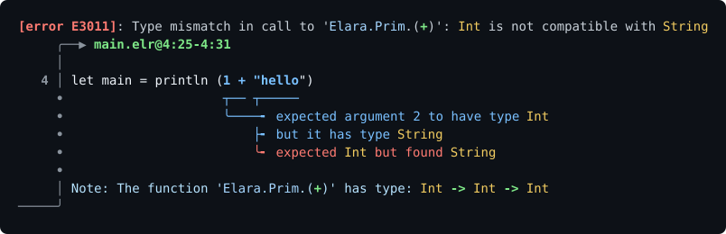

<h1 align="center">Elara</h1>
<p align="center">
A Haskell-like purely functional language for the JVM
</p>

<p align="center">
  <a href="https://github.com/ElaraLang/elara/actions/workflows/ci.yaml"></a>
  <a href="https://elara.readthedocs.io/en/latest/"></a>
  <a href="LICENSE"></a>
  <a href="https://discord.gg/xu5gSTV"></a>
</p>

<p align="center">
  <a href="https://elara.readthedocs.io/en/latest/">Documentation</a> ·
  <a href="https://elaralang.github.io/elara/">Compiler API reference</a> ·
  <a href="examples/">Examples</a> ·
  <a href="https://discord.gg/xu5gSTV">Discord</a>
</p>

> [!WARNING]
> Elara is currently a work in progress, expect a lot of breaking changes and unfinished features!

## A Brief Example

```fs
import Elara.Prim


type Option a = None | Some a

def map : (a -> b) -> Option a -> Option b
let map f opt =
    match opt with
        None -> None
        Some x -> Some (f x)

def main : IO ()
let main = println (map (\x -> x * 2) (Some 3))

-- Prints: Some 6
```

## Why Elara?

Elara was made to try and achieve two things. If you like the sound of these, Elara could be for you:

- **A Haskell-like language on the JVM platform** _with high quality interoperability_ (todo)
- **A modern Elm and Rust-like developer experience**

In general, Elara also has some pretty cool features:

- **Haskell- and F#-style, on the JVM.** Algebraic data types, pattern matching and inferred Hindley-Milner polymorphism, compiled to JVM bytecode.
- **High Quality Rust- and Elm-Style Error Messages**:
    <p align="center"></p>
- **Modern Compiler Architecture**: A query-based compiler with constraint-based Hindley-Milner inference.

<details>
  <summary> Comparison with other languages</summary>

|                          | **Elara**  | Haskell | [Frege](https://github.com/Frege/frege) | [Eta](https://github.com/typelead/eta) |  Scala 3  |   Elm   | Gleam |
| ------------------------ | :--------: | :-----: | :-------------------------------------: | :------------------------------------: | :-------: | :-----: | :---: |
| Runs on the JVM          |     ✅     |   ❌    |                   ✅                    |                   ✅                   |    ✅     |   ❌    |  ❌   |
| Effects tracked in types |     ✅     |   ✅    |                   ✅                    |                   ✅                   |    ❌     |   ✅    |  ❌   |
| Full type inference      |     ✅     |   ✅    |                   ✅                    |                   ✅                   | ⚠️ partly |   ✅    |  ✅   |
| Type classes / traits    | ⚠️ planned |   ✅    |                   ✅                    |                   ✅                   |    ✅     |   ❌    |  ❌   |
| Actively maintained      |     ✅     |   ✅    |                ⚠️ quiet                 |                   ❌                   |    ✅     | ⚠️ slow |  ✅   |
| Production-ready         |     ❌     |   ✅    |                   ⚠️                    |                   ⚠️                   |    ✅     |   ✅    |  ✅   |

<sub>✅ yes · ⚠️ partly · ❌ no</sub>

</details>

## Quick Start

**1. Get Elara**

```sh
# prebuilt statically-linked binary for x86-64 Linux, see the Releases page for others
curl -fsSL https://github.com/ElaraLang/elara/releases/download/dev-build/elara-x86_64-linux -o elara
chmod +x elara
```

or build from source with [Nix](https://nixos.org/): `nix develop`, then `just build`.
You'll also need a [JDK](https://whichjdk.com/) if using the JVM backend.

For detailed build instructions see the [documentation](https://elara.readthedocs.io/en/latest/compiler/internals/setup.html)

**2. Write a program**

```fs
-- hello.elr
import Prelude
import Elara.Prim

def main : IO ()
let main = println "Hello, World!"
```

**3. Run it**

```sh
./elara run hello.elr                 # run in the interpreter
./elara run hello.elr --target jvm    # compile to JVM bytecode and run on the JVM
```

More runnable programs are in [`examples/`](examples/), demonstrating features like pattern matching, higher-order functions, polymorphism, a [JSON parser](examples/json_parser.elr), and more.


## Status

Elara is still in early stages. So far, we have a full working pipeline (parse → rename → typecheck → Core → JVM / Interpreter), a small standard library, and a golden-tested set of examples and error messages. See the [changelog](CHANGELOG.md) for what's changed recently.

## Contributing

Contributions are always very welcome! Start with [`CONTRIBUTING.md`](CONTRIBUTING.md) and the [development setup](https://elara.readthedocs.io/en/latest/compiler/internals/setup.html), then look for issues labelled [`good first issue`](https://github.com/ElaraLang/elara/labels/good%20first%20issue). If you have questions, ask on [Discord](https://discord.gg/xu5gSTV).

## Library Acknowledgments

Elara owes its existence to numerous open-source projects, particularly to [Grace](https://github.com/Gabriella439/grace) for its use as a reference implementation for type checking.

## License

Elara is released under the [MIT License](LICENSE).
